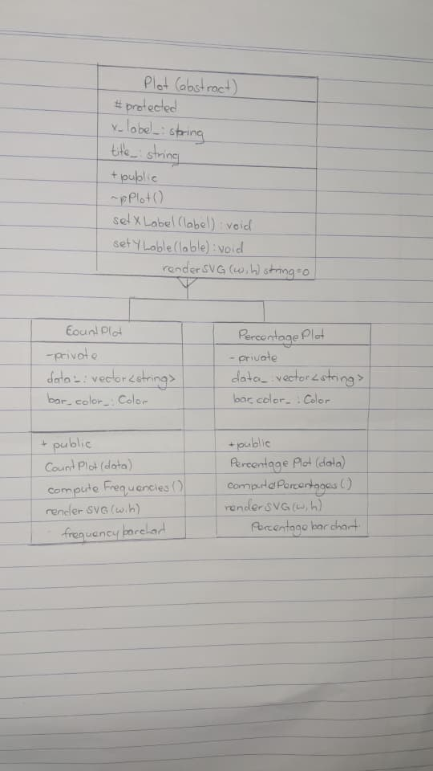
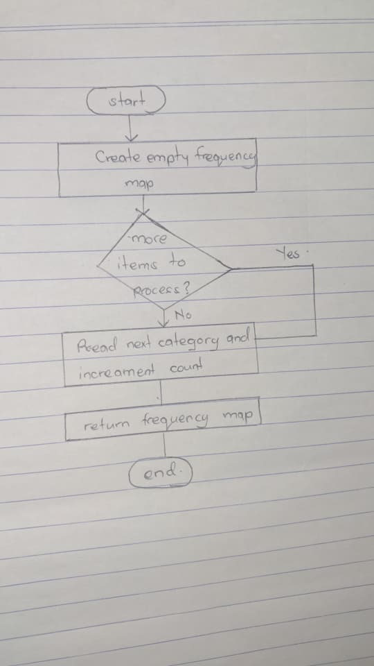

## 1. Introduction

This project involves developing a C++ program that analyzes categorical data and generates bar charts using Scalable Vector Graphics (SVG). The program demonstrates three major Object-Oriented Programming (OOP) principles: encapsulation, inheritance, and polymorphism.

The program consists of three main classes: `Plot`, `CountPlot`, and `PercentagePlot`.

## 2. Objectives

- To implement encapsulation, inheritance, and polymorphism in C++.
- To calculate category frequencies and percentages.
- To generate bar charts using SVG.
- To improve code reusability and organization.

## 3. Implementation of OOP Concepts

### 3.1 Encapsulation

Encapsulation involves combining data and functions within a class while restricting direct access to internal data.

In this program, `CountPlot` and `PercentagePlot` use private data members such as `data_` and `bar_color_`. Public functions provide controlled access to the program's functionality.

### 3.2 Inheritance

Inheritance allows one class to acquire properties and functions from another class.

The `Plot` class acts as the base class, while `CountPlot` and `PercentagePlot` inherit from it.

Both derived classes reuse common properties such as the chart title and axis labels, reducing code repetition.

### 3.3 Polymorphism

Polymorphism allows different classes to implement the same function differently.

The base class `Plot` declares a virtual function called `renderSVG()`, which is overridden in both derived classes.

`CountPlot` generates a frequency bar chart, while `PercentagePlot` generates a percentage bar chart.

## 4. Algorithms Implemented

### 4.1 Frequency Counting Algorithm

The frequency counting algorithm determines how many times each category appears in a dataset.

It uses `std::map` to store categories and their corresponding frequencies.

For example, the dataset:

Apple, Banana, Apple, Orange, Banana, Apple

produces:

- Apple = 3
- Banana = 2
- Orange = 1

### 4.2 Percentage Calculation Algorithm

This algorithm calculates the percentage contribution of each category using:

**Percentage = (Category Frequency / Total Observations) × 100**

The results are:

- Apple = 50%
- Banana = 33.33%
- Orange = 16.67%

### 4.3 SVG Rendering Algorithm

The SVG rendering algorithm converts the calculated frequencies and percentages into bar charts.

It determines the position, width, and height of each bar before generating SVG elements.

The program produces two files: `count_plot.svg` and `percentage_plot.svg`.

## 5. Class Design

The program contains the following classes:

- **Plot:** Abstract base class containing common chart properties and virtual functions.
- **CountPlot:** Derived class responsible for frequency counting and frequency chart generation.
- **PercentagePlot:** Derived class responsible for percentage calculations and percentage chart generation.
- **Color:** Structure used to store RGB color values.

The class diagrams illustrating access specifiers, member functions, data members, and inheritance relationships are provided separately as hand-drawn illustrations.

## 6. Conclusion

The project successfully demonstrates the application of encapsulation, inheritance, and polymorphism in C++.

The frequency counting, percentage calculation, and SVG rendering algorithms provide a practical method of analyzing and visualizing categorical data.

The use of OOP principles improves code organization, reusability, and maintainability.

## 7. References

1. Stroustrup, B. (2013). *The C++ Programming Language* (4th ed.). Addison-Wesley.
2. Cormen, T. H., et al. (2022). *Introduction to Algorithms* (4th ed.). MIT Press.
3. cppreference. *C++ Standard Library*. https://en.cppreference.com/w/cpp
4. Mozilla Developer Network. *SVG Documentation*. https://developer.mozilla.org/en-US/docs/Web/SVG

## Project Images

